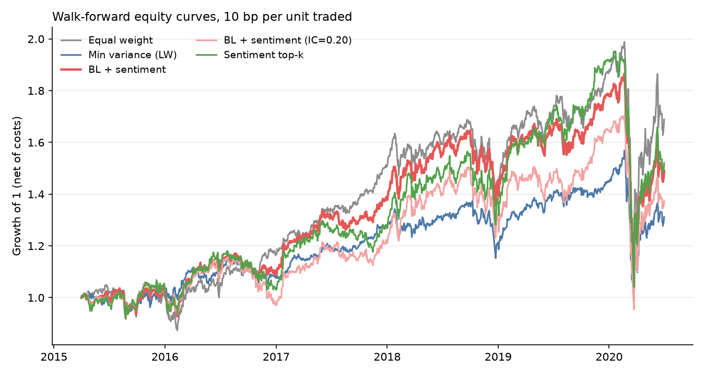
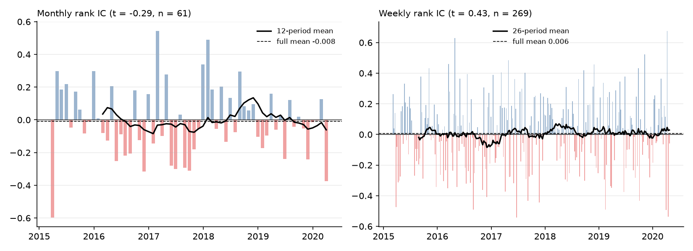
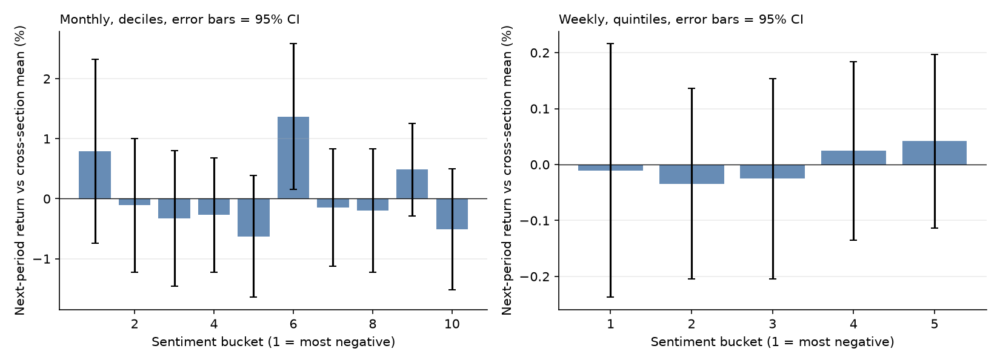

# Results

Out-of-sample window: 2015-04-01 to 2020-06-30
(1322 trading days, 62 monthly rebalances), 29 US stocks,
45,545 scored headlines. Costs: 10 bp per unit of traded notional. Risk-free rate is
taken as zero for every strategy. Sharpe confidence intervals are stationary-bootstrap
(5,000 resamples, mean block 21 days); differences versus equal weight use paired resamples.

## Portfolios

| Strategy | CAGR | Vol | Sharpe (net) | 95% CI | Sharpe (gross) | Max DD | Turnover/yr | Sharpe diff vs EW (95% CI) |
|---|---:|---:|---:|---|---:|---:|---:|---|
| Equal weight | 10.5% | 21.3% | 0.58 | [-0.19, 1.52] | 0.58 | -42.2% | 40% | - |
| Min variance (LW) | 5.3% | 17.2% | 0.39 | [-0.31, 1.31] | 0.40 | -37.1% | 125% | -0.19 [-0.58, +0.20] |
| BL + sentiment | 7.9% | 21.2% | 0.46 | [-0.29, 1.38] | 0.52 | -44.5% | 599% | -0.11 [-0.38, +0.15] |
| BL + sentiment (IC=0.20) | 6.2% | 21.8% | 0.39 | [-0.37, 1.27] | 0.45 | -44.0% | 712% | -0.19 [-0.65, +0.18] |
| Sentiment top-k | 8.3% | 22.2% | 0.47 | [-0.33, 1.42] | 0.53 | -46.6% | 683% | -0.11 [-0.54, +0.30] |

Sentiment strategies that beat equal weight with the paired Sharpe-difference interval strictly
above zero: none.



### Sensitivity of net Sharpe to the cost assumption

| Strategy | 0 bp | 10 bp | 25 bp | 50 bp |
|---|---:|---:|---:|---:|
| Equal weight | 0.58 | 0.58 | 0.57 | 0.56 |
| Min variance (LW) | 0.40 | 0.39 | 0.36 | 0.33 |
| BL + sentiment | 0.52 | 0.46 | 0.38 | 0.24 |
| BL + sentiment (IC=0.20) | 0.45 | 0.39 | 0.29 | 0.12 |
| Sentiment top-k | 0.53 | 0.47 | 0.38 | 0.22 |

## Does sentiment predict returns?

Rank information coefficient of the decayed FinBERT signal against the next-period return
(execution one trading day after the decision date).

| Horizon | n | Mean IC | t-stat | Bootstrap 95% CI | Hit rate |
|---|---:|---:|---:|---|---:|
| monthly | 61 | -0.008 | -0.29 | [-0.060, 0.045] | 44% |
| weekly | 269 | 0.006 | 0.43 | [-0.017, 0.030] | 53% |

Top-minus-bottom quintile spread of next-month return (relative to the cross-section mean):
-0.35% per month, t = -0.59. Weekly quintile spread: 0.05% per week, t = 0.33.




## Parameters

```
BacktestConfig(first_rebalance='2015-03-01', last_rebalance='2020-05-01', cov_lookback=252, news_halflife_days=15.0, news_window_days=90, max_weight=0.2, cost_bps=10.0, top_k=6, min_headlines=2.0, delta=2.5, tau=0.05, assumed_ic=0.05, conf_ref_count=5.0, execution_lag_days=1, news_lag_days=0)
```
